# 🏥 Système d'Information Hospitalier (SIH)

Application web PHP/MySQL de gestion hospitalière : dossiers patients, diagnostics,
examens, suivi de croissance des enfants, pharmacie et réquisitions de médicaments
avec workflow d'approbation et notification par e-mail.

**Interface entièrement en français · design moderne · mode clair / sombre.**

---

## 📸 Aperçu de l'application

### Connexion
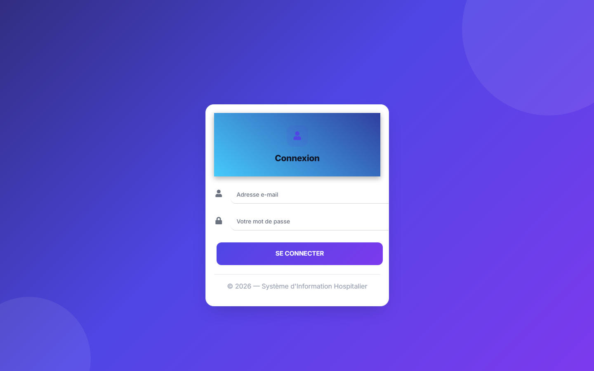

### Accueil administrateur
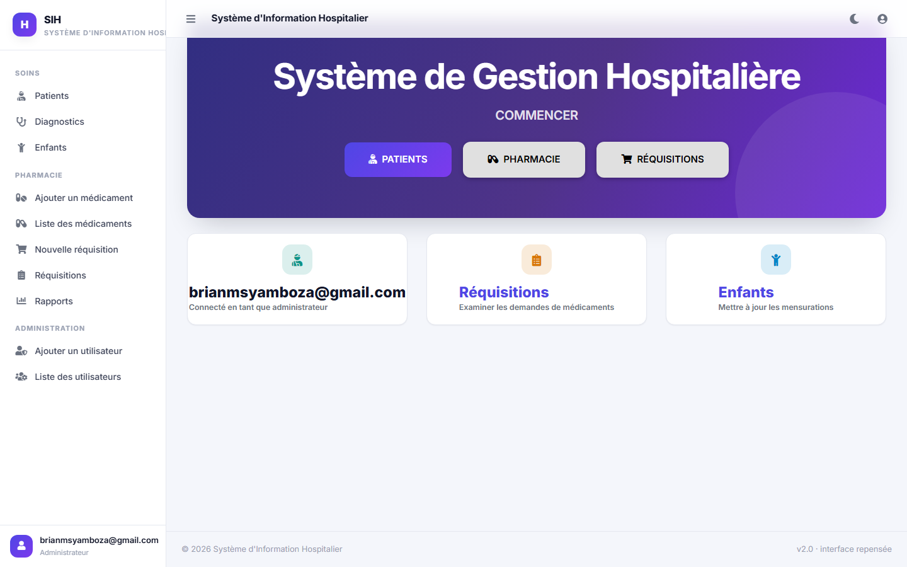

### Mode sombre
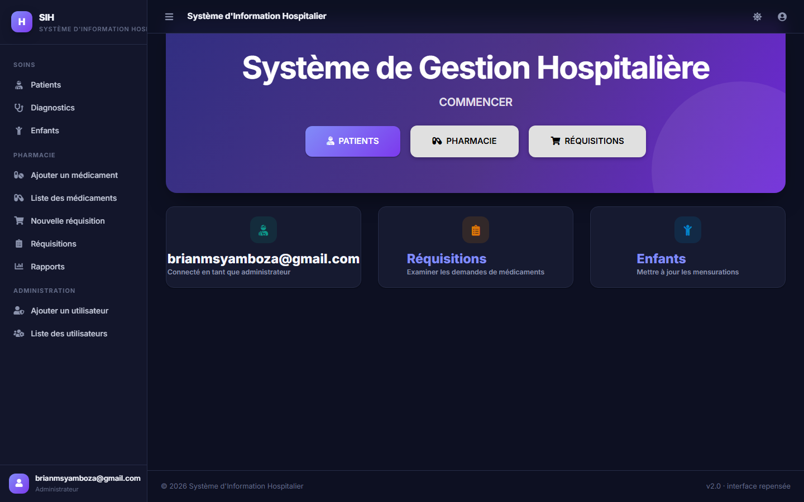

### Patients
| Liste des patients | Ajouter un patient |
|---|---|
| 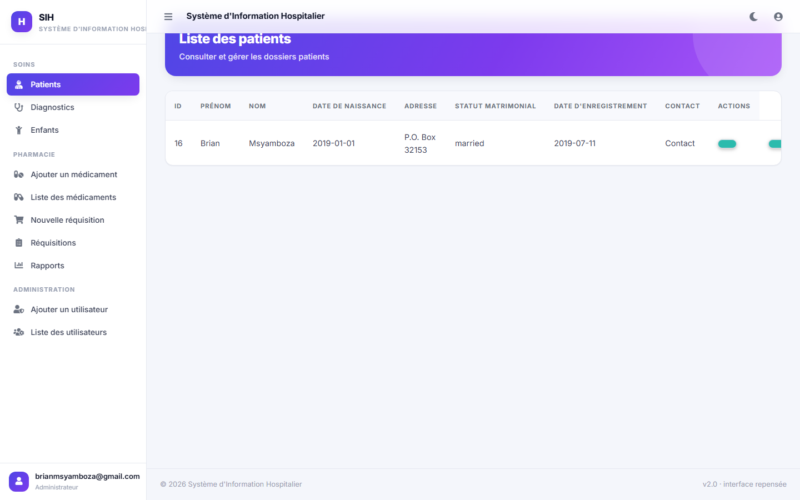 | 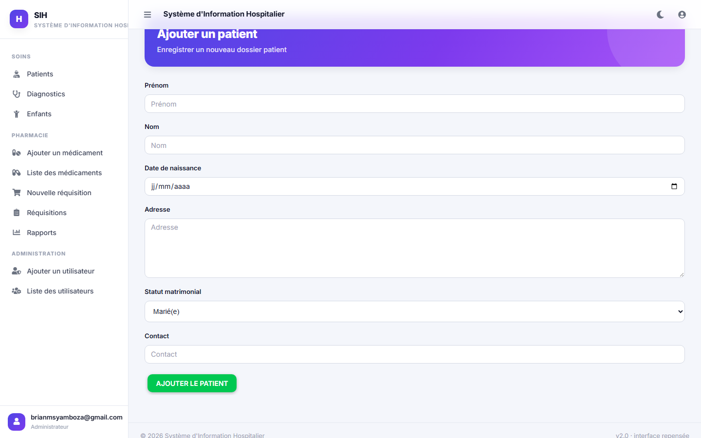 |

| Formulaire de diagnostic | Diagnostics |
|---|---|
| 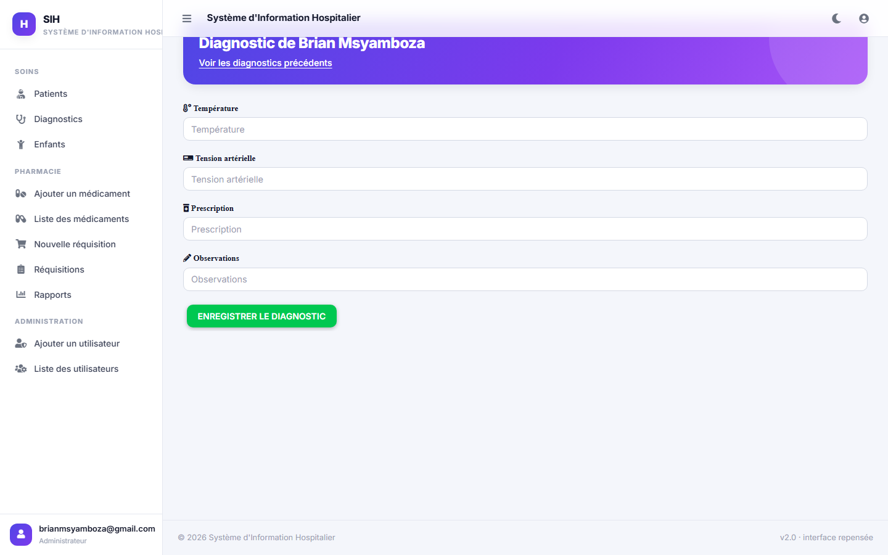 | 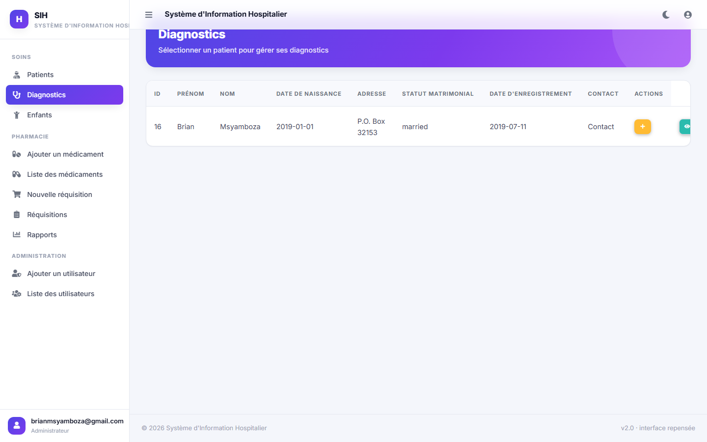 |

### Examens médicaux
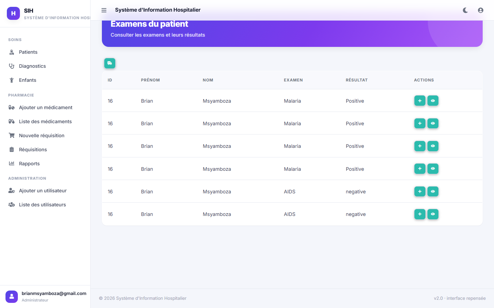

### Suivi de croissance des enfants
| Liste des enfants | Courbe de croissance (percentiles OMS) |
|---|---|
| 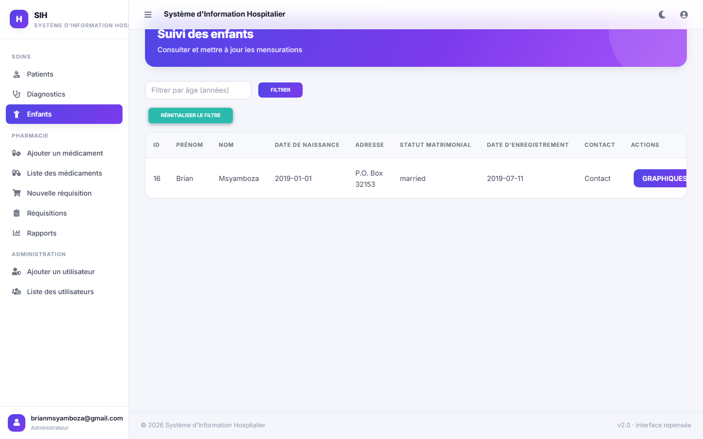 | 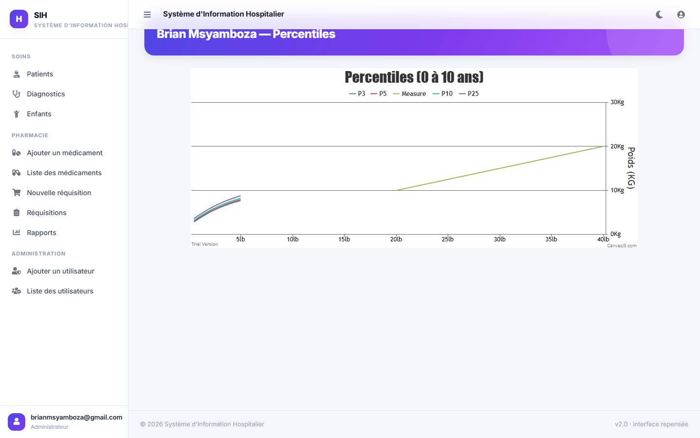 |

### Pharmacie
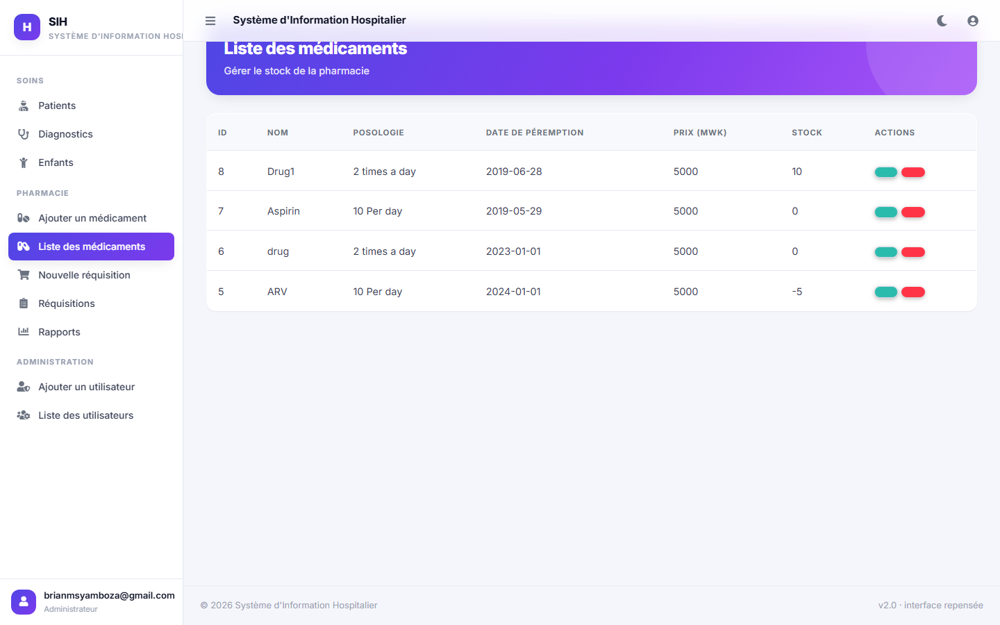

### Réquisitions de médicaments
| Panier de réquisition | Suivi des réquisitions |
|---|---|
| 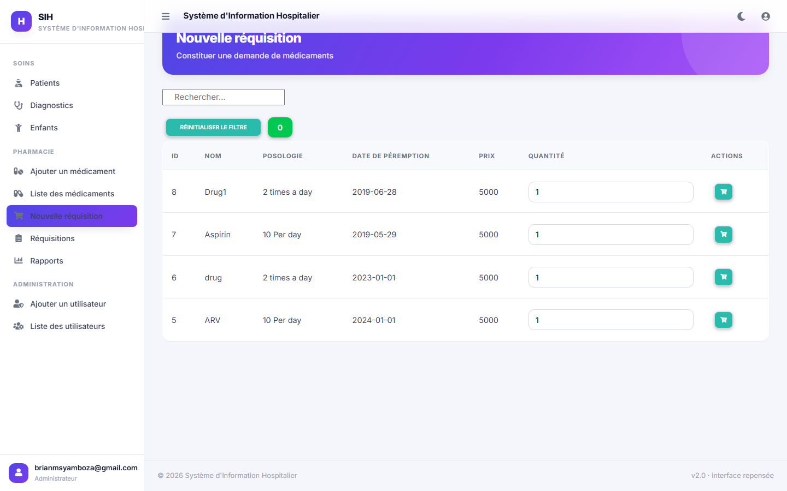 | 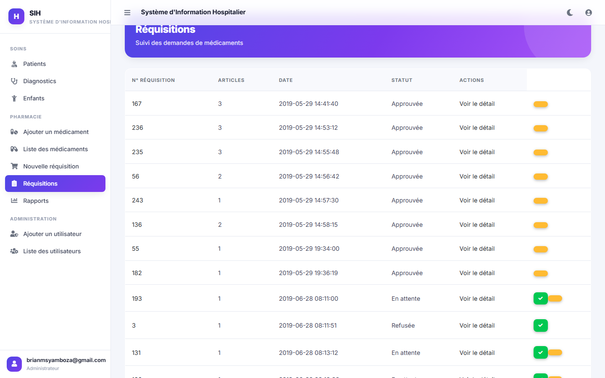 |

| Rapport de consommation |
|---|
| 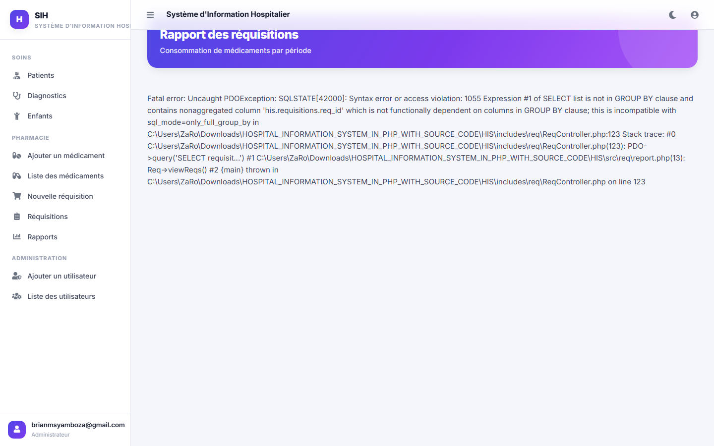 |

### Utilisateurs
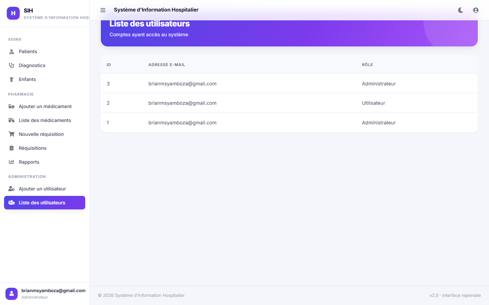

---

## ⚙️ Prérequis

- **PHP 7.2+** (PHP 8.x compatible) avec les extensions `pdo_mysql`
- **MySQL 5.7+ / MariaDB 10.1+**
- Un serveur web (Apache/XAMPP/WAMP) ou le serveur intégré de PHP

## 🚀 Installation

### 1. Récupérer le projet

```bash
git clone <url-du-depot>
cd his
```

### 2. Créer la base de données

Le script d'import crée la base `his` et charge le jeu de données de démonstration :

```bash
php scripts/import_db.php
```

> Connexion MySQL par défaut attendue : `root` sans mot de passe sur `127.0.0.1`
> (réglable dans `includes/DBconn.php`).

### 3. Migrer les mots de passe (recommandé)

Les comptes de démonstration livrés dans `his.sql` utilisent déjà des hachages bcrypt.
Si vous importez une base plus ancienne contenant des mots de passe en clair :

```bash
php migrate_passwords.php
```

Le script est idempotent : les mots de passe déjà hachés sont ignorés. Par ailleurs,
le système **rehache automatiquement** chaque ancien mot de passe lors de la
prochaine connexion réussie de l'utilisateur concerné.

### 4. Lancer l'application

Avec le serveur intégré de PHP (développement) :

```bash
php -S 127.0.0.1:8090
```

Puis ouvrir <http://127.0.0.1:8090/> — ou déposer le dossier dans `htdocs` (XAMPP)
et ouvrir `http://localhost/his/`.

### 5. Se connecter

| Rôle | Identifiant | Mot de passe |
|---|---|---|
| Administrateur | `brianmsyamboza@gmail.com` | `123` |
| Utilisateur | `brianmsyamboza@gmail.com` | `1234` |

> ⚠️ Comptes de démonstration : changez-les avant toute utilisation réelle.

---

## ✨ Fonctionnalités

### 👥 Patients
- Création, modification, suppression de dossiers patients
- Orientation (« référence ») d'un patient vers un autre hôpital avec motif

### 🩺 Diagnostics & examens
- Enregistrement des constantes (température, tension), prescriptions et observations
- Examens de laboratoire avec résultats, rattachés au dossier patient

### 📈 Suivi de croissance (enfants)
- Mensurations : poids, taille, périmètre crânien, IMC
- **5 graphiques de percentiles OMS** : poids/âge, taille/âge, poids/taille,
  IMC/âge, périmètre crânien/âge

### 💊 Pharmacie (admin)
- Gestion du stock de médicaments : ajout, modification, suppression, recherche
- Prix, posologie et dates de péremption

### 📋 Réquisitions
- Panier de demande de médicaments, validation par un administrateur
- Workflow **en attente → approuvée / refusée**
- Décrément automatique et contrôlé du stock (transaction SQL, verrouillage de
  lignes, stock jamais négatif)
- Notification par e-mail à l'utilisateur demandeur
- Rapport graphique de consommation filtrable par période

### 🔐 Sécurité
- Requêtes SQL **préparées** (PDO) sur l'authentification et les écritures sensibles
- Mots de passe hachés avec **bcrypt** (`password_hash` / `password_verify`)
- **Rehash transparent** lors des connexions (migration douce des anciens comptes)
- **Contrôles de rôle côté serveur** (`requireRole('admin')`) sur la gestion des
  médicaments, des utilisateurs et l'approbation des réquisitions — masquer un lien
  de menu ne suffit pas
- Protection contre la **fixation de session** (`session_regenerate_id`)
- Redirections d'authentification qui **interrompent l'exécution** (les données de
  page ne fuient pas)

### 🎨 Interface
- Design system maison : palette indigo, typographie **Inter**, cartes arrondies,
  ombres douces
- **Mode clair / sombre** (bouton dans la barre supérieure, préférence mémorisée,
  respect des préférences système)
- Navigation latérale responsive (off-canvas sur mobile), surlignage de la page active
- Alertes modernes (SweetAlert2), graphiques interactifs (CanvasJS)

---

## 🗂️ Structure du projet

```
├── index.php                  # Redirection vers la page de connexion
├── his.sql                    # Schéma + données de démonstration
├── migrate_passwords.php      # Migration CLI des mots de passe en clair
├── scripts/
│   └── import_db.php          # Création de la base + import SQL
├── includes/                  # Logique partagée
│   ├── DBconn.php             # Connexion PDO
│   ├── Session.php            # Sessions, rôles, redirections
│   ├── dao.php                # Amorçage d'une page authentifiée
│   ├── header.php             # <head> : polices, CSS, script anti-flash de thème
│   ├── sidenav.php            # Shell applicatif : barre latérale + barre supérieure
│   ├── footer.php             # Scripts + pied de page
│   ├── jumbo.php              # Bandeau d'en-tête de page
│   ├── users/                 # UsersController
│   ├── patients/              # PatientsController
│   ├── tests/                 # TestsController
│   ├── presp/                 # PrespController (médicaments)
│   └── req/                   # ReqController + panier
├── src/                       # Pages (vues + AJAX)
│   ├── index/                 # Connexion, déconnexion
│   ├── admin/                 # Accueil
│   ├── patients/ · diag/      # Patients, diagnostics, examens
│   ├── growth/                # Suivi de croissance + graphiques
│   ├── presp/ · req/          # Pharmacie, réquisitions
│   └── users/                 # Gestion des comptes
├── public/                    # CSS / JS / polices / images
│   ├── css/style.css          # Design system (thèmes clair & sombre)
│   └── js/theme.js            # Thème, barre latérale, navigation active
└── docs/screenshots/          # Captures d'écran du README
```

## 🛠️ Stack technique

| Couche | Technologie |
|---|---|
| Backend | PHP (procédural + classes simples), PDO |
| Base de données | MySQL / MariaDB (InnoDB) |
| Frontend | Bootstrap 4, Material Design Bootstrap, jQuery |
| Design system | CSS variables maison (`public/css/style.css`) |
| Alertes | SweetAlert2 |
| Graphiques | CanvasJS |
| E-mail | PHPMailer (SMTP) |

## ⚠️ Limitations connues

- Le panier des réquisitions est stocké dans un fichier texte partagé
  (`includes/req/cart.txt`) : à remplacer par une table SQL pour un usage multi-utilisateurs
- Les identifiants SMTP sont codés en dur dans `includes/req/ReqController.php` :
  à déplacer dans des variables d'environnement et **révoquer** (ils ont fuité dans
  l'historique Git)
- Pas de protection CSRF ni de limitation de tentatives de connexion
- `patients.user_id` et `users.user_id` sont deux séquences indépendantes :
  un nettoyage du schéma (clés étrangères) serait bienvenu

## 📄 Licence

Projet pédagogique — libre d'utilisation et de modification.
